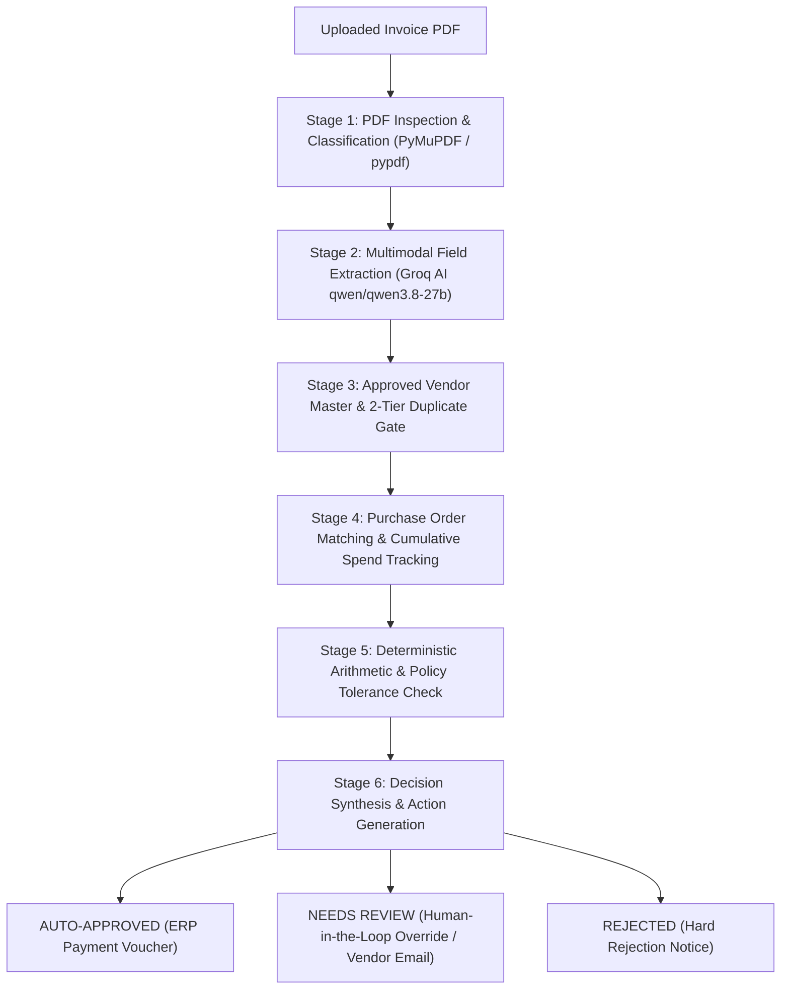

# Autonomous Accounts Payable (AP) Invoice Processor

An automated, intelligent, and policy-compliant Accounts Payable Invoice Processing application built with **Python**, **Streamlit**, and **Groq AI** (`qwen/qwen3.8-27b`).

The system ingests machine-readable and scanned image invoice PDFs, extracts structured billing data with zero hallucination, executes a 6-stage deterministic compliance and PO matching engine, and generates ERP-ready payment vouchers or contextual vendor clarification notices.

---

## Architecture: 6-Stage AP Pipeline



1. **Stage 1 — PDF Inspection & Classification**: Computes SHA-256 fingerprint, extracts raw text with `pypdf`, and classifies document as native digital text or scanned raster image ($<40$ characters extracted).
2. **Stage 2 — AI Multimodal Field Extraction**: Calls Groq's high-speed API (`qwen/qwen3.8-27b`) for structured JSON extraction, rendering scanned pages to 150 DPI PNGs for vision extraction. Strictly enforces zero hallucination (missing fields are reported as `null` and cataloged in `missing_fields`).
3. **Stage 3 — Vendor Master & 2-Tier Duplicate Gate**: Validates vendor against the Approved Vendor Master (AVM). Evaluates Tier 1 exact SHA-256 file hash match and Tier 2 near-duplicate match (same vendor + identical amount within a 14-day policy window).
4. **Stage 4 — PO Matching & Cumulative Spend**: Resolves explicit PO references or runs fuzzy implicit matching based on description word overlap and amount proximity. Computes historical spend, current invoice amount, cumulative total, and remaining balance.
5. **Stage 5 — Deterministic Math & Tolerance Validation**: Verifies internal arithmetic ($subtotal + tax = total$ or $\sum lines = total$). Checks cumulative spend against PO limits using policy tolerance rules ($\pm 2.0\%$ auto-approval cap up to $\$250.00$).
6. **Stage 6 — Decision Synthesis & Next Action**: Synthesizes final decision (`AUTO-APPROVED`, `NEEDS REVIEW`, or `REJECTED`), generates plain-English reasoning, produces structured ERP payment voucher payloads or vendor emails, and updates `data/store.json`.

---

## Built-in Demo Scenarios

The repository includes a standalone test invoice generator (`data/generate_test_pdfs.py`) that produces 5 realistic enterprise test PDFs inside `sample_invoices/`:

| Scenario | File | Characteristics & Edge Case Evaluated | Expected Decision |
| :--- | :--- | :--- | :--- |
| **01. Happy Path** | `01_happy_path_acme.pdf` | Clean digital invoice from Acme Cloud Solutions (\$4,100 + \$400 tax = \$4,500) matching `PO-2026-101`. | `AUTO-APPROVED` |
| **02. Split PO Overbill** | `02_split_po_overbill_apex.pdf` | Apex Logistics invoice for \$6,200. Combined with prior \$10,000 billed on `PO-2026-102` (\$15,000 budget), pushes cumulative spend to \$16,200 (+8% over budget). | `NEEDS REVIEW` |
| **03. Scanned Missing Fields** | `03_scanned_missing_fields_nova.pdf` | Scanned raster image PDF (**0 selectable text characters**) with $1.5^\circ$ skew and scanner noise. Onerously omits Invoice Date and PO number. Implicitly matches `PO-2026-103`. | `NEEDS REVIEW` |
| **04. Near-Duplicate Check** | `04_near_duplicate_acme.pdf` | Invoice `INV-882-R` from Acme Cloud Solutions for \$2,400 submitted within 3 days of historical `INV-882` (\$2,400) on `PO-2026-099`. | `REJECTED` |
| **05. Tax Embedded Tolerance** | `05_tax_embedded_tolerance_summit.pdf` | Summit Office Systems single line item for \$5,070 (Tax Inclusive) against `PO-2026-104` (\$5,000 budget). Overbill is +\$70 (+1.4%), well within the 2% / \$250 policy tolerance. | `AUTO-APPROVED` |

---

## Project Structure

```
ap-invoice-processor/
├── app.py                      # Streamlit multipage application (3 Tabs)
├── test_pipeline.py            # CLI verification script
├── requirements.txt            # Minimal dependencies
├── .env.example                # Environment configuration template
├── README.md                   # Project documentation & deployment guide
├── data/
│   ├── __init__.py
│   ├── seed_data.py            # Vendors, POs, policy rules, and baseline run history
│   ├── db.py                   # JSON persistence helper functions
│   ├── store.json              # Local active database state
│   └── generate_test_pdfs.py   # Test invoice PDF generator (ReportLab + Pillow)
├── engine/
│   ├── __init__.py
│   ├── schemas.py              # Pydantic models (ExtractedInvoice, StageResult, PipelineReport)
│   ├── extractor.py            # Stage 1 inspection & Stage 2 Groq multimodal extraction
│   ├── rules.py                # Stages 3-6 deterministic business rules & ERP actions
│   └── pipeline.py             # Sequential generator orchestrating Stages 1-6
└── sample_invoices/            # Generated sample invoice PDFs
```

---

## Local Setup & Quickstart

### 1. Clone & Install Dependencies
Ensure you have Python 3.10+ installed:
```bash
git clone <your-repo-url>
cd ap-invoice-processor
pip install -r requirements.txt
```

### 2. Configure Environment Variables
Copy `.env.example` to `.env` and provide your Groq API key (available free at [console.groq.com](https://console.groq.com)):
```bash
cp .env.example .env
```
Inside `.env`:
```ini
GROQ_API_KEY=gsk_your_groq_api_key_here
```
*(Note: If no API key is provided, the application automatically engages a high-precision deterministic regex fallback parser so testing never fails.)*

### 3. Generate Test Invoices & Seed Persistence Store
```bash
python data/generate_test_pdfs.py
```

### 4. Run CLI Pipeline Verification
```bash
python test_pipeline.py
```

### 5. Launch the Streamlit Web Application
```bash
streamlit run app.py
```
Open your browser at `http://localhost:8501`.

---

## Streamlit Community Cloud Deployment

To deploy on [Streamlit Community Cloud](https://streamlit.io/cloud):

1. **Push Repository to GitHub**:
   Ensure `ap-invoice-processor` is pushed to a public or private GitHub repository.

2. **Deploy on Streamlit Cloud**:
   - Log into Streamlit Cloud and click **"New app"**.
   - Select your repository, branch, and set **Main file path** to `app.py` (or `ap-invoice-processor/app.py` if deployed from a monorepo).

3. **Configure Secrets**:
   - In the Streamlit Cloud dashboard for your app, open **Settings** > **Secrets**.
   - Add your Groq API key:
     ```toml
     GROQ_API_KEY = "gsk_your_groq_api_key_here"
     ```
   - The application automatically checks `os.getenv("GROQ_API_KEY")` and falls back to `st.secrets["GROQ_API_KEY"]`.

4. **Deploy**:
   Click **Save**. The app will build dependencies from `requirements.txt` and launch instantly.
